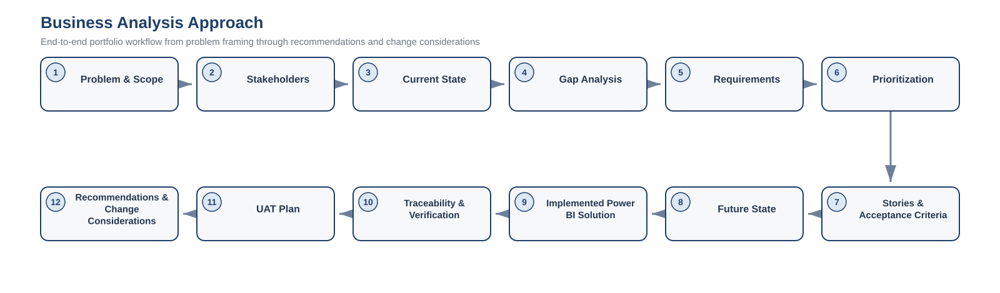
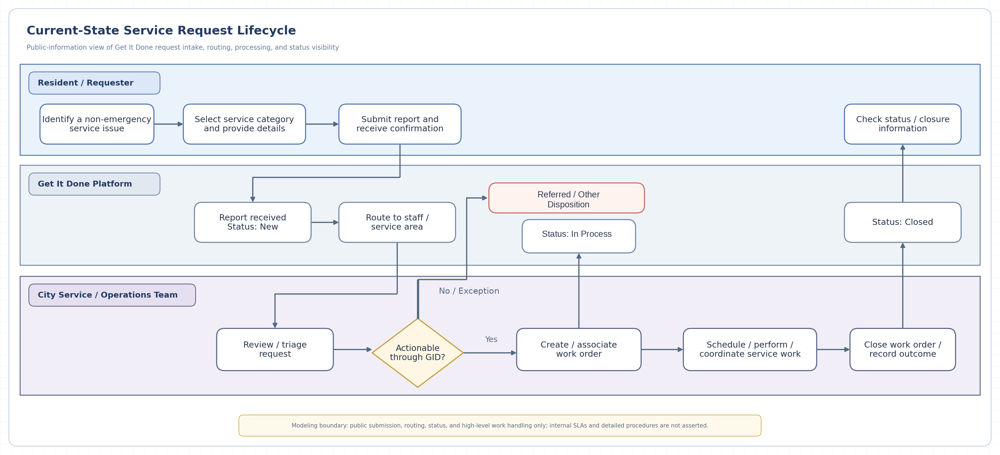
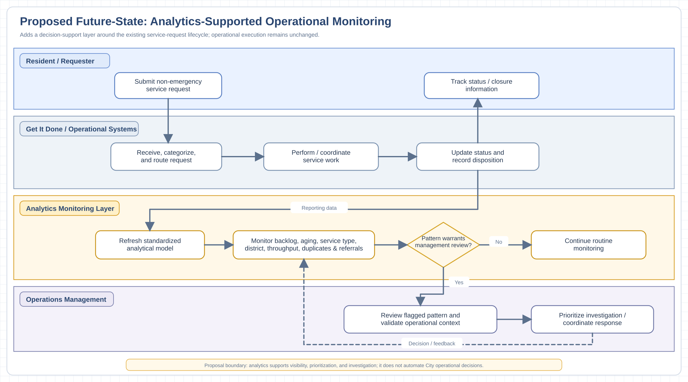

# San Diego Service Operations - Business Analysis Case Study

> **Portfolio case study:** This repository demonstrates an end-to-end Business Analysis approach built around a completed Power BI analysis of public City of San Diego Get It Done service-request data. It does **not** represent City employment, internal system access, stakeholder interviews, approved City requirements, or formal City acceptance.

## Start Here

For the fastest review, open the **[Master Business Analysis Case Study (PDF)](case-study/00_Master_Business_Analysis_Case_Study.pdf)**. It tells the complete story in one document.

For the underlying analytical implementation, see the companion **[San Diego Service Operations Power BI project](https://github.com/ChaseBrangham/san-diego-service-operations)**.

This repository is intentionally organized in two layers:

1. **Recruiter / hiring-manager layer:** this README and the master case-study PDF explain the project from problem through recommendation.
2. **BA artifact layer:** the detailed workbooks, process maps, requirements, traceability, testing, governance, and implementation documents provide evidence behind the narrative.

---

## Executive Snapshot

The companion analytics project consolidated approximately **800,000** public Get It Done service-request records and produced an operational reporting model focused on backlog, aging, throughput, geography, service categories, duplicates, and referrals.

| Indicator | Observed result | Why it matters |
|---|---:|---|
| Total modeled requests | ~800K | Establishes the scale of operational activity analyzed |
| Open backlog | ~86K | Indicates the active workload represented in the snapshot |
| Open backlog aged 90+ days | ~75.1% | Signals a substantial concentration of long-open requests for further review |
| Median age of open requests | ~367 days | Provides another view of backlog aging severity |
| Largest district backlog | District 3, ~19.2K | Identifies a geographic concentration that warrants contextual investigation |
| Duplicate rate | ~13.1% | Indicates repeated reporting is material enough to monitor |
| Referral rate | ~6.0% | Shows a meaningful share of requests leave the Get It Done workflow through referral |

These are **descriptive findings**, not causal conclusions. The public dataset does not establish staffing levels, internal service-level agreements, department capacity, root causes, or whether every closed request corresponds to completed physical work.

---

## 1. Business Problem

Get It Done service operations span many request types, geographic areas, dates, and workflow outcomes. The core business-analysis problem is therefore **operational visibility and prioritization**: decision-makers need a consistent way to understand where unresolved workload is accumulating, how long it has remained open, which services and districts contribute most to backlog, and whether incoming requests are being offset by requests leaving the workflow.

The project deliberately avoids defining the problem as "the City needs a dashboard." A dashboard is a potential solution. The underlying need is better decision support.

### Business need

Operational decision-makers need a consolidated, consistently defined view of request volume, backlog age, service mix, geography, throughput, duplicate reporting, and referral activity so that areas requiring investigation can be identified and discussed using a common set of metrics.

---

## 2. Business Analysis Approach



Because the Power BI solution existed before this portfolio extension, the BA documentation is intentionally **retrospective**. Requirements are labeled as reconstructed or proposed rather than falsely represented as stakeholder-approved pre-development requirements.

The case study follows four evidence classes:

- **Publicly supported facts** from City of San Diego documentation and open data.
- **Observed analytical findings** from the completed Power BI project.
- **Reconstructed requirements** based on the implemented analytical capabilities and business questions.
- **Proposed BA design** such as stakeholder engagement, future-state workflow, governance, and UAT roles that would require validation in a live engagement.

---

## 3. Current-State Analysis

### Publicly supportable service-request lifecycle



The current-state map is intentionally high-level. Public City documentation supports the submission, routing, status, closure, and referral concepts, but it does not expose detailed internal department procedures, work-order logic, staffing, or SLAs.

### Key observed operational signals

The data and dashboard identified several areas that would become discovery topics in a live BA engagement:

- **Backlog aging:** roughly three-quarters of the open backlog in the analyzed snapshot was 90+ days old.
- **Service concentration:** Sidewalk Repair Issues and Street Light Maintenance each represented about 14.8K open requests; ROW Maintenance was also a major contributor.
- **Geographic concentration:** Council District 3 contained the largest open backlog at roughly 19.2K requests.
- **Throughput imbalance:** monthly request intake frequently exceeded dispositions, though some periods showed the reverse.
- **Duplicate reporting:** approximately 13.1% of modeled requests were identified as duplicates, with especially high duplicate rates in some high-volume categories.
- **Referral activity:** approximately 6.0% of requests were referred outside the directly visible Get It Done workflow.
- **Data-quality exposure:** around 800 apparent date-conversion errors were ultimately traced to CSV parsing of quoted multiline text, demonstrating why ingestion validation is part of the business solution, not just a technical cleanup task.

### Gap analysis

The detailed **[Current-State & Gap Analysis](process-analysis/12_Current_State_and_Gap_Analysis.xlsx)** connects observed conditions to desired decision capabilities. Examples include:

| Current-state limitation | Desired state | Proposed capability |
|---|---|---|
| Backlog exists across many records and categories | Leaders can quickly identify aging workload | Backlog and 90+ day KPIs with aging analysis |
| Geographic concentration is difficult to interpret record by record | Managers can compare workload by district | Council-district backlog analysis and filters |
| Intake and workflow exits occur on different dates | Throughput can be compared on a common timeline | Separate Requests Received and Requests Dispositioned measures using a shared Date model |
| Duplicate and referral patterns can be overlooked | Exception patterns are visible and consistently defined | Duplicate and referral KPIs plus supporting definitions |
| Public data does not explain causation | Findings are separated from hypotheses | Explicit evidence boundaries and root-cause hypothesis log |

The workbook also maintains **root-cause hypotheses separately from findings**. For example, high duplicate activity may relate to long-open visible conditions or resident status visibility, but the public data cannot prove either cause. Those questions would require stakeholder discovery and additional operational evidence.

---

## 4. Stakeholder Analysis

The **[Stakeholder Analysis](stakeholders/02_Stakeholder_Analysis.xlsx)** identifies proposed stakeholder groups and demonstrates how a BA would tailor engagement based on information needs, influence, and interest.

Representative groups include operations leadership, department/service managers, operational analysts, council-district stakeholders, Get It Done platform/reporting owners, frontline workflow participants, and residents/requesters.

Because no City interviews occurred, these are **proposed stakeholder groups**, not confirmed project participants. In a live engagement, the stakeholder register would be validated before requirements were baselined.

Useful previews:

- [Stakeholder Register](previews/02_Stakeholder_Register.png)
- [Power-Interest Matrix](previews/02_Power_Interest_Matrix.png)
- [Engagement Plan](previews/02_Engagement_Plan.png)

---

## 5. Requirements and Prioritization

The requirements package separates the **business need** from the **solution behavior**.

- **Business requirements** explain the decision capability needed.
- **Functional requirements** define what the analytical solution must do.
- **Non-functional requirements** address usability, consistency, documentation, and maintainability.
- **Business rules and data requirements** define metric logic, source expectations, data-quality treatment, and interpretation rules.

The current catalog contains **27 requirements** across business, functional, and non-functional categories. It includes backlog, aging, geography, service category, monthly throughput, filtering, metric governance, duplicate monitoring, and referral monitoring.

### Prioritization

The **[Requirements Prioritization](requirements/15_Requirements_Prioritization.xlsx)** uses both MoSCoW and a weighted scoring model based on business value, decision criticality, risk/integrity, dependency, and relative implementation effort.

The purpose is not to pretend the scoring is objectively final. It demonstrates how a BA can make prioritization **explicit, challengeable, and traceable** rather than assigning "High" or "Low" without rationale.

### Agile translation

The **[User Stories & Acceptance Criteria](requirements/06_User_Stories_and_Acceptance_Criteria.xlsx)** translates the requirements into **11 user stories** with testable acceptance criteria. A Jira-ready CSV is included under [`jira/`](jira/).

---

## 6. KPI, Data, and Business-Rule Governance

An analytics solution is only useful if stakeholders agree on what the numbers mean.

The **[KPI & Data Dictionary](requirements/13_KPI_and_Data_Dictionary.xlsx)** formally documents metrics such as:

- Total Requests
- Open Backlog
- 30+ Day Backlog
- 90+ Day Backlog
- 90+ Day Backlog Rate
- Median Open Case Age
- Requests Received
- Requests Dispositioned
- Net Request Flow
- Duplicate Requests / Duplicate Rate
- Referred Requests / Referral Rate

The dictionary also documents underlying fields and whether definitions come from the public dataset or are derived in the analytical model.

The **[Business Rules & Data Requirements](requirements/14_Business_Rules_and_Data_Requirements.xlsx)** captures rules that are easy to miss in a dashboard-only portfolio, including:

- open vs. inactive status handling;
- use of separate request and closure dates;
- duplicate identification through the parent-request relationship;
- treatment of Referred as a workflow exit rather than proof of physical issue resolution;
- explicit preservation of missing categories as `Unknown`;
- consistent filter behavior;
- validation of CSV field alignment before records enter the model.

This is one of the main ways the BA extension moves beyond visualization into **definition and governance**.

---

## 7. Proposed Future State



The proposed future state adds an **analytics-supported monitoring layer** rather than inventing a replacement for internal City operational systems.

At a high level:

1. Public/operational request data feeds the analytical model.
2. Defined KPIs monitor backlog, aging, service mix, geography, throughput, duplicates, and referrals.
3. Significant trends or concentrations become management-review signals.
4. Management investigates the context before deciding whether an operational response is warranted.
5. Outcomes and metric definitions are reviewed over time.

The model intentionally distinguishes **analytical signal detection** from **causal diagnosis**.

---

## 8. Implemented Power BI Solution

The original analytical solution is a two-page Power BI report using Power Query, a dimensional date model, and DAX.

### Executive Overview


The Executive Overview provides high-level visibility into total workload, open backlog, aging, top service categories, district concentration, and requests versus dispositions.

### Backlog & Process Analysis


The deeper analysis page focuses on monthly net request flow, open backlog by district and service type, aging buckets, duplicate patterns, and referral activity.

See **[Solution Evidence](solution-evidence/Solution_Evidence.md)** for the evidence register and direct links to the companion analytics repository.

---

## 9. Traceability: From Need to Validation

The **[Requirements Traceability Matrix](traceability/07_Requirements_Traceability_Matrix.xlsx)** is the backbone of the case study. It links business requirements to functional requirements, stories, Power BI capabilities, and planned validation.

A representative chain is:

**BR-02 - identify long-open backlog**  
→ **FR-03 - calculate open requests aged 90+ days**  
→ **US-02 - operations leader needs visibility into aged backlog**  
→ **Power BI capability - Backlog ≥90 Days KPI**  
→ **UAT-02 - validate that only open requests aged at least 90 days are counted**

This demonstrates why a feature exists and how it would be accepted, rather than treating the dashboard as a collection of visuals.

---

## 10. Verification vs. UAT

The case study deliberately separates two concepts.

### Analyst solution verification

The **[Solution Verification workbook](testing/17_Solution_Verification.xlsx)** records what can be independently evidenced from the completed Power BI project, public screenshots, documentation, and metric logic. It marks visual/static evidence as verified where support exists and leaves interaction-specific items partial when they cannot be independently demonstrated from static evidence.

### User Acceptance Testing

The **[UAT Plan & Test Cases](testing/08_UAT_Plan_and_Test_Cases.xlsx)** defines **14 business-facing acceptance scenarios**, including backlog, aging, filtering, throughput, duplicate, and referral behavior.

Formal UAT remains **Planned / Not Executed** because there are no authorized City business users participating in this portfolio case study. That boundary is intentional: analyst verification is not presented as stakeholder acceptance.

---

## 11. Risks, Assumptions, Issues, and Dependencies

The **[RAID Log](project-management/16_RAID_Log.xlsx)** makes project uncertainty visible rather than burying it in narrative text.

Examples include:

- risk of over-interpreting public data as proof of root cause;
- absence of internal staffing, budget, SLA, and work-order context;
- dependency on public-data availability and field consistency;
- assumption that public status definitions are sufficient for a portfolio-level lifecycle model;
- issue that the original solution predates the formal BA requirements package.

The **[Decision & Assumption Log](project-management/10_Decision_and_Assumption_Log.xlsx)** separately records important reasoning choices and the evidence/validation status behind them.

---

## 12. Recommendations

The analysis supports **investigation priorities**, not unverified operational directives.

Recommended next steps include:

1. Prioritize review of service categories where high backlog volume and severe aging occur together, especially Sidewalk Repair, Street Light Maintenance, ROW Maintenance, and Pavement Maintenance.
2. Investigate the unusually high duplicate concentration in Street Light Maintenance before prescribing a process change.
3. Review District 3 backlog in context of population, service mix, infrastructure characteristics, and department ownership before making resource-allocation conclusions.
4. Monitor Requests Received, Requests Dispositioned, and Net Request Flow together to identify sustained periods of backlog pressure.
5. Validate duplicate, referral, aging, and disposition definitions with operational stakeholders before using them as production governance metrics.
6. In a live engagement, extend the model with staffing/capacity, work-order, SLA/target, cost, and actual resolution-outcome data where authorized and available.

---

## 13. Implementation and Change Considerations

The **[Implementation & Change Considerations](implementation/18_Implementation_and_Change_Considerations.pdf)** addresses what would happen after analysis in a real organization: ownership, metric validation, phased rollout, training, requirements/change control, support, and adoption measurement.

This keeps the case study from ending at "build a dashboard." It considers how a solution would become a governed business capability.

---

## 14. Reflection

The **[Project Reflection](reflection/19_Project_Reflection.pdf)** explains what changed when the original analytics project was reframed through a Business Analyst lens.

The most important lesson is that **analysis alone does not establish requirements, causation, or acceptance**. The BA layer adds structured problem framing, evidence boundaries, stakeholder needs, metric definitions, process context, traceability, validation planning, and change considerations around the technical solution.

---

# Artifact Library

| # | Artifact | Purpose | File / preview |
|---:|---|---|---|
| **00** | Master Business Analysis Case Study | Recruiter-facing end-to-end narrative | [PDF](case-study/00_Master_Business_Analysis_Case_Study.pdf) · [DOCX](case-study/00_Master_Business_Analysis_Case_Study.docx) |
| **01** | Project Overview & Scope | Problem, need, objectives, boundaries, success criteria | [PDF](docs/01_Business_Analysis_Project_Overview_and_Scope.pdf) · [DOCX](docs/01_Business_Analysis_Project_Overview_and_Scope.docx) |
| **02** | Stakeholder Analysis | Stakeholder needs, influence, interest, engagement | [XLSX](stakeholders/02_Stakeholder_Analysis.xlsx) · [Preview](previews/02_Stakeholder_Register.png) |
| **03** | Current-State Process Map | Public-information-supported current lifecycle | [PNG](process-maps/03_Current_State_Process_Map.png) · [draw.io](process-maps/03_Current_State_Process_Map.drawio) |
| **04** | Proposed Future-State Process Map | Proposed analytics-supported monitoring process | [PNG](process-maps/04_Proposed_Future_State_Map.png) · [draw.io](process-maps/04_Proposed_Future_State_Map.drawio) |
| **05** | Requirements Catalog | Business, functional, and non-functional requirements | [XLSX](requirements/05_Requirements_Catalog.xlsx) · [Preview](previews/05_Requirements_Catalog.png) |
| **06** | User Stories & Acceptance Criteria | Agile translation of requirements | [XLSX](requirements/06_User_Stories_and_Acceptance_Criteria.xlsx) · [Preview](previews/06_Story_Backlog.png) |
| **07** | Requirements Traceability Matrix | Requirement-to-story-to-solution-to-test linkage | [XLSX](traceability/07_Requirements_Traceability_Matrix.xlsx) · [Preview](previews/07_Traceability_Matrix.png) |
| **08** | UAT Plan & Test Cases | Business-facing acceptance scenarios | [XLSX](testing/08_UAT_Plan_and_Test_Cases.xlsx) · [Preview](previews/08_UAT_Test_Cases.png) |
| **09** | Solution Evaluation & Recommendations | Coverage, findings, interpretation limits, next actions | [PDF](evaluation/09_Solution_Evaluation_and_Recommendations.pdf) · [DOCX](evaluation/09_Solution_Evaluation_and_Recommendations.docx) |
| **10** | Decision & Assumption Log | Reasoning, assumptions, validation needs, source register | [XLSX](project-management/10_Decision_and_Assumption_Log.xlsx) · [Preview](previews/10_Decision_Log.png) |
| **11** | Jira-Ready Backlog | Epics, stories, ACs, requirements for Jira practice | [CSV](jira/11_Jira_Backlog_Import.csv) · [Import notes](jira/Jira_Import_Notes.md) |
| **12** | Current-State & Gap Analysis | Findings, gaps, desired state, hypotheses | [XLSX](process-analysis/12_Current_State_and_Gap_Analysis.xlsx) · [Preview](previews/12_Gap_Analysis.png) |
| **13** | KPI & Data Dictionary | Metric definitions, fields, governance | [XLSX](requirements/13_KPI_and_Data_Dictionary.xlsx) · [Preview](previews/13_KPI_Dictionary.png) |
| **14** | Business Rules & Data Requirements | Calculation, interpretation, data, and quality rules | [XLSX](requirements/14_Business_Rules_and_Data_Requirements.xlsx) · [Preview](previews/14_Business_Rules.png) |
| **15** | Requirements Prioritization | MoSCoW plus weighted scoring rationale | [XLSX](requirements/15_Requirements_Prioritization.xlsx) · [Preview](previews/15_Requirements_Prioritization.png) |
| **16** | RAID Log | Risks, assumptions, issues, dependencies | [XLSX](project-management/16_RAID_Log.xlsx) · [Preview](previews/16_RAID_Log.png) |
| **17** | Solution Verification | Analyst evidence check separate from stakeholder UAT | [XLSX](testing/17_Solution_Verification.xlsx) · [Preview](previews/17_Solution_Verification.png) |
| **18** | Implementation & Change Considerations | Ownership, rollout, governance, adoption, support | [PDF](implementation/18_Implementation_and_Change_Considerations.pdf) · [DOCX](implementation/18_Implementation_and_Change_Considerations.docx) |
| **19** | Project Reflection | Lessons, limitations, live-engagement next steps | [PDF](reflection/19_Project_Reflection.pdf) · [DOCX](reflection/19_Project_Reflection.docx) |

Additional evidence and source documentation:

- [Solution Evidence](solution-evidence/Solution_Evidence.md)
- [References & Limitations](sources/References_and_Limitations.md)
- [Companion Analytics Project README snapshot](sources/Companion_Analytics_Project_README.md)
- [`previews/`](previews/) contains GitHub-friendly rendered views of spreadsheet artifacts.

---

## Repository Structure

```text
san-diego-service-operations-business-analysis/
├── README.md
├── case-study/
├── docs/
├── stakeholders/
├── process-maps/
├── process-analysis/
├── requirements/
├── traceability/
├── testing/
├── evaluation/
├── project-management/
├── implementation/
├── reflection/
├── solution-evidence/
├── jira/
├── sources/
└── previews/
```

---

## What This Case Study Demonstrates

**Business Analysis:** problem framing, scope management, stakeholder analysis, current/future-state analysis, gap analysis, process mapping, requirements definition, prioritization, user stories, acceptance criteria, traceability, UAT planning, solution evaluation, business rules, RAID management, and change considerations.

**Analytics / BI:** Power BI, Power Query, DAX, KPI design, dimensional modeling, data profiling, data-quality troubleshooting, operational reporting, and analytical storytelling.

**Professional judgment:** separating evidence from assumptions, distinguishing descriptive findings from causation, documenting limitations, and refusing to present simulated stakeholder activity as real project approval.

---

## Evidence Boundaries

This portfolio project intentionally does **not** claim:

- City of San Diego stakeholder interviews, workshops, observation, or sign-off;
- access to internal work-order systems, staffing, budgets, targets, or department procedures;
- that 90 days is an official City SLA;
- that Closed or Referred automatically proves the underlying physical issue was resolved;
- that any observed district or service-category pattern proves a specific operational root cause;
- that planned UAT scenarios were executed by authorized City users.

For source grounding and interpretation rules, see **[References & Limitations](sources/References_and_Limitations.md)**.
